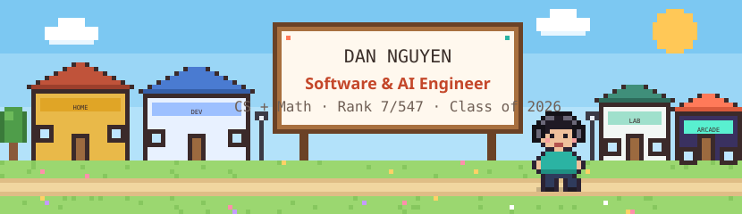
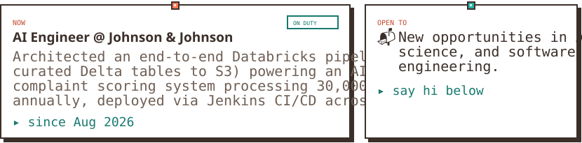
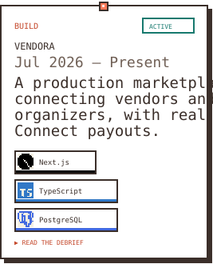
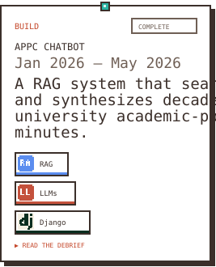
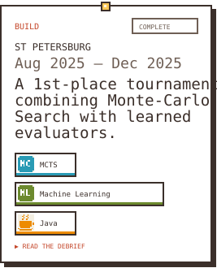
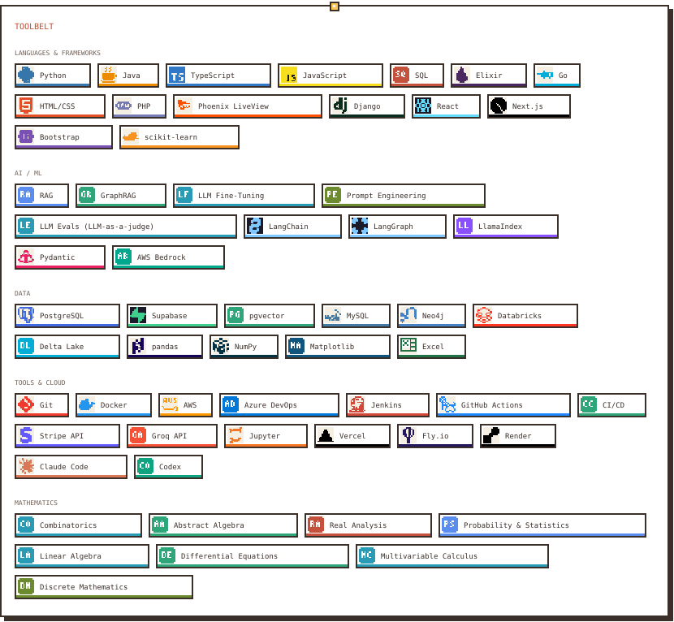
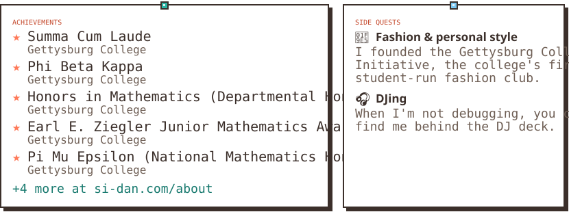

<!--
  Generated by dan-town/packages/readme from the canonical profile (dan-profile/profile.yaml).
  Do not edit by hand: it is rebuilt and pushed by dan-town's CI whenever the profile changes.
-->

<a href="https://si-dan.com"><picture><source media="(prefers-color-scheme: dark)" srcset="readme/banner-dark.svg"></picture></a>

<picture><source media="(prefers-color-scheme: dark)" srcset="readme/typing-dark.svg"></picture>

<b>I build intelligent, AI-driven applications that solve real-world problems.</b> I'm a Software and AI Engineer. I graduated 7th in my class (of 547) with a B.S. in Computer Science and Mathematics from Gettysburg College.

<picture><source media="(prefers-color-scheme: dark)" srcset="readme/now-dark.svg"></picture>

<picture><source media="(prefers-color-scheme: dark)" srcset="readme/h-builds-dark.svg"></picture>

<a href="https://si-dan.com/projects/vendora"><picture><source media="(prefers-color-scheme: dark)" srcset="readme/build-vendora-dark.svg"></picture></a><a href="https://si-dan.com/projects/appc-chatbot"><picture><source media="(prefers-color-scheme: dark)" srcset="readme/build-appc-chatbot-dark.svg"></picture></a><a href="https://si-dan.com/projects/st-petersburg"><picture><source media="(prefers-color-scheme: dark)" srcset="readme/build-st-petersburg-dark.svg"></picture></a>

<a href="https://si-dan.com/dev">All projects at the Dev Center →</a>

<a href="https://si-dan.com/dev"><picture><source media="(prefers-color-scheme: dark)" srcset="readme/stack-dark.svg"></picture></a>

<a href="https://si-dan.com/about"><picture><source media="(prefers-color-scheme: dark)" srcset="readme/achievements-dark.svg"></picture></a>

<picture><source media="(prefers-color-scheme: dark)" srcset="readme/h-radio-dark.svg"></picture>

<a href="https://si-dan.com/about"><picture><source media="(prefers-color-scheme: dark)" srcset="https://si-dan.com/api/readme/on-repeat.svg?theme=dark"></picture></a>

<picture><source media="(prefers-color-scheme: dark)" srcset="readme/h-activity-dark.svg"></picture>

<picture><source media="(prefers-color-scheme: dark)" srcset="https://raw.githubusercontent.com/dannguyen111/dannguyen111/output/profile-3d-dark.svg"></picture>

<picture><source media="(prefers-color-scheme: dark)" srcset="https://raw.githubusercontent.com/dannguyen111/dannguyen111/output/snake-dark.svg"></picture>

<picture><source media="(prefers-color-scheme: dark)" srcset="readme/h-hi-dark.svg"></picture>

<a href="https://github.com/dannguyen111"><picture><source media="(prefers-color-scheme: dark)" srcset="readme/link-github-dark.svg"></picture></a>
<a href="https://www.linkedin.com/in/dannguyen111/"><picture><source media="(prefers-color-scheme: dark)" srcset="readme/link-linkedin-dark.svg"></picture></a>
<a href="mailto:sidan.nguyen@gmail.com"><picture><source media="(prefers-color-scheme: dark)" srcset="readme/link-email-dark.svg"></picture></a>
<a href="https://www.depop.com/dnngn/"><picture><source media="(prefers-color-scheme: dark)" srcset="readme/link-depop-dark.svg"></picture></a>

<a href="https://si-dan.com"><picture><source media="(prefers-color-scheme: dark)" srcset="readme/visit-dark.svg"></picture></a>

🏡 This README is drawn from the same profile as <a href="https://si-dan.com">my pixel town</a>, and redraws itself whenever I update it.

